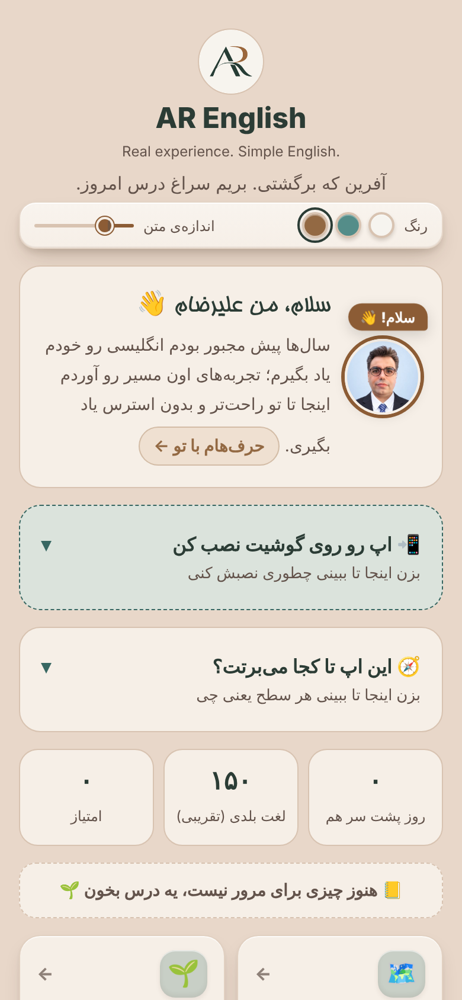
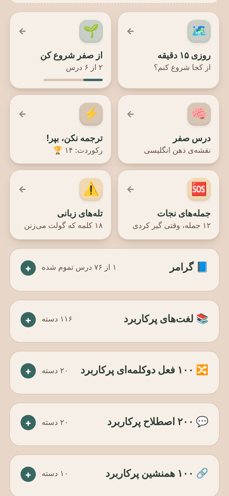
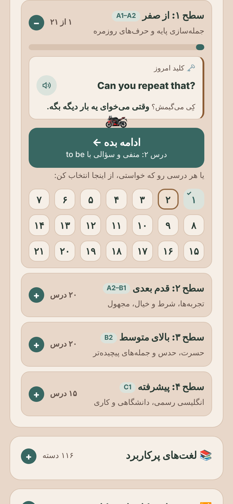
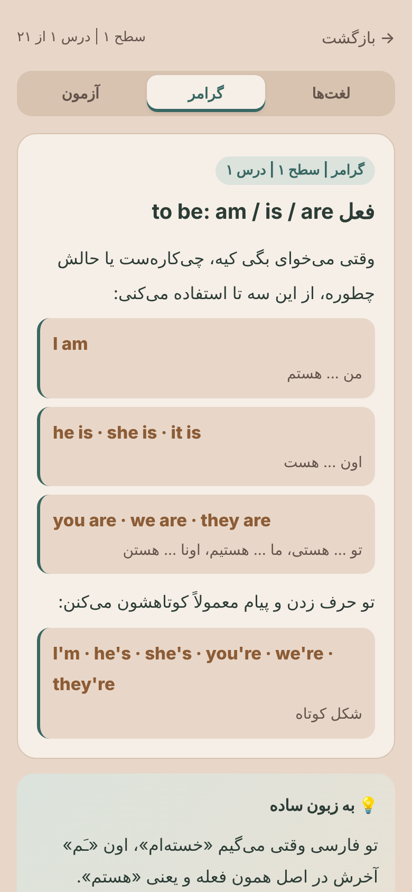
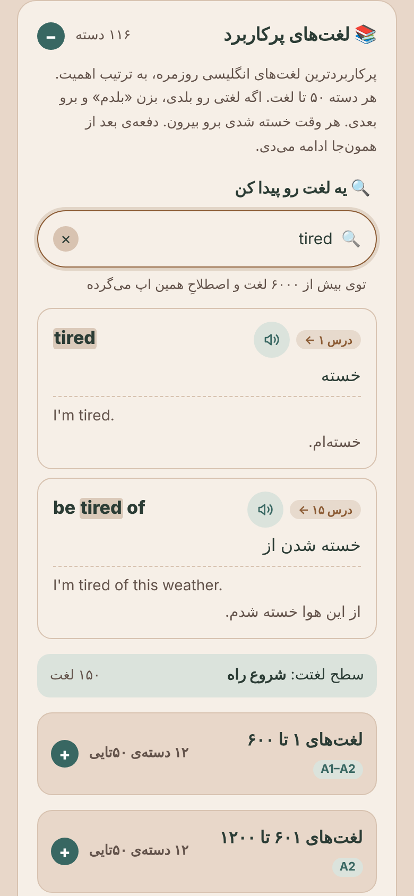

# AR English · Real experience. Simple English.

A free English-learning app for Persian speakers, designed and written by Alireza Rajabi.

**Try it live:** https://alirezarajabi.com/learn-english/

## About the project
- 76 grammar lessons in 4 levels (A1 to C1), plus a "from zero" track for absolute beginners
- 5,760 everyday words with example sentences, 100 phrasal verbs, 200 idioms and 100 collocations
- Sentence of the day, daily key phrases, a speed game, review system and badges
- Installable on the phone (PWA) and works offline
- Fully right-to-left Persian interface with three color themes and adjustable text size

## Screenshots

## Source code
This repository is a showcase only. The source code is private and is not published here.

© 2026 Alireza Rajabi. All rights reserved.
